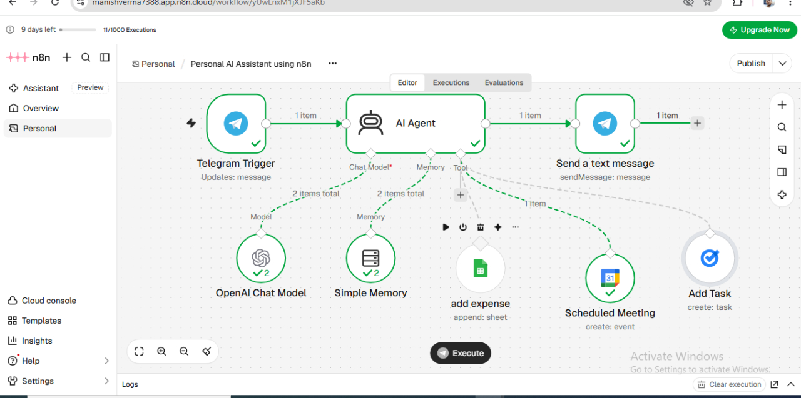

# Telegram AI Personal Assistant using n8n

An AI-powered personal assistant built using n8n, Telegram, and OpenAI. This project demonstrates how AI Agents and workflow automation can help manage everyday productivity tasks through a Telegram chatbot.

## Project Overview

The assistant uses an AI Agent to understand user messages and connect with productivity tools. The workflow includes memory and integrations for managing expenses, scheduling meetings, and creating tasks.

## Technologies Used

- n8n – Workflow Automation
- OpenAI – AI Language Model
- Telegram Bot API – Chat Interface
- Google Sheets – Expense Management
- Google Calendar – Meeting Scheduling
- Simple Memory – Conversation Context

## Key Features

- Telegram-based interaction
- AI-powered message understanding
- Context-aware conversations using memory
- Expense entry through Google Sheets
- Meeting scheduling through Google Calendar
- Task management integration

## Workflow Blueprint

The following image shows the n8n workflow architecture:

## Core Features and Architecture

- **Telegram Trigger:** Receives user messages through a Telegram bot.
- **AI Agent:** Processes user requests using the OpenAI Chat Model.
- **Simple Memory:** Maintains conversation context.
- **Add Expense:** Connects expense requests to Google Sheets.
- **Scheduled Meeting:** Connects meeting requests to Google Calendar.
- **Add Task:** Connects task requests to a task-management tool.
- **Telegram Response:** Sends responses back to the user.

## Requirements and Dependencies

- n8n instance (self-hosted or cloud)
- OpenAI API key
- Telegram Bot API token
- Google Sheets and Google Calendar credentials
- Credentials for the configured task-management integration

## How to Setup and Import

1. Open the `workflows` folder in this repository.
2. Download `telegram-ai-assistant.json`.
3. Open your n8n dashboard.
4. Create a new workflow.
5. Select **Import from File**.
6. Upload the downloaded JSON file.
7. Configure your own Telegram, OpenAI, Google, and task-management credentials.
8. Save and test the workflow.
## Configuration Required

Before running this workflow:

1. Import the JSON file into n8n.
2. Configure Telegram Bot credentials.
3. Configure OpenAI API credentials.
4. Configure Google Sheets credentials and Sheet ID.
5. Configure Google Calendar credentials.
6. Configure Google Tasks credentials and Task List ID.
7. Test each tool before activating the workflow.

Note: This repository contains a sanitized workflow template.
No personal credentials or API keys are included.  

**Note:** This repository contains a workflow template. You must configure your own credentials and test each integration before using it.
